# Deep Reinforcement Learning-Based Adaptive Congestion-Aware Routing for QoS-Aware Computer Networks

*Project report — Computer Networks (AI/ML specialisation)*

---

## Abstract

Static shortest-path routing ignores traffic: when the shortest paths of several flows overlap,
their links congest while alternative paths stay idle, increasing delay and packet loss. This
project builds a packet-level network simulator and trains a Deep Q-Network (DQN) that chooses the
next hop of each packet from the current state of the network (queue occupancy, queueing delay,
bandwidth, distance to destination and one-hop downstream congestion). Action masking prevents
routing loops. The agent is compared with static shortest-path routing and a congestion-aware
Dijkstra heuristic that recomputes link costs every 10 ms, over light, moderate, heavy and
dynamically changing traffic, on held-out random seeds and on traffic matrices not seen during
training. In this simulator, both adaptive methods eliminate the heavy losses of shortest-path routing (which loses 16–53 % of packets once load reaches 0.75 or more). Up to the network's capacity (load ≤ 1.25) the DQN and the heuristic both deliver every packet, with the DQN giving lower average delay (e.g. 10.0 vs 13.3 ms at load 1.0) and much lower jitter (1.4 vs 4.5 ms). Under overload (load ≥ 1.5) the heuristic delivers slightly more packets (e.g. 98.6 % vs 97.4 % at load 1.5; 0.6–1.2 percentage points) while the DQN keeps lower delay and jitter. On ten unseen traffic matrices the DQN matched the heuristic's delivery ratio and had lower delay in 15 of 20 paired cases. These are simulation results with stated limitations.

---

## 1. Introduction

Routing decides the path packets take from source to destination. Interior gateway protocols
such as OSPF compute shortest paths using administratively fixed link weights. This is simple and
stable, but it does not adapt when the load changes: links on popular shortest paths can become
congested — long queues, high delay, tail-drop losses — while longer paths have spare capacity.

Quality of Service (QoS) is measured through end-to-end delay, jitter, throughput and packet
loss. Improving QoS under changing traffic requires routing that reacts to the network state.
Reinforcement learning (RL) is a natural fit: an agent observes the network, chooses routes, and
learns from the delay and loss that result, without a hand-written model of the traffic.

**Objectives**

1. Model a network of interconnected routers and links with bandwidth, propagation delay and
   finite queues.
2. Simulate packet traffic with varying load and link degradation.
3. Measure link utilisation, queues, delay, jitter, loss and throughput.
4. Implement a DQN agent that chooses valid next hops.
5. Implement shortest-path and congestion-aware baselines.
6. Evaluate all methods under light, moderate, heavy and changing load.
7. Provide an interactive dashboard and a reproducible evaluation.

"Congestion-free" in the title denotes the objective — minimising congestion — not a guarantee.
When offered traffic exceeds the network's capacity, loss is unavoidable for any routing scheme.

## 2. Background and related work

**Shortest-path and load-aware routing.** Dijkstra's algorithm with static weights underlies
link-state protocols such as OSPF. Load-sensitive link costs were explored early (e.g. ARPANET's
delay-based metric) and suffer from oscillation when all traffic switches path simultaneously —
behaviour our heuristic baseline also shows as high jitter.

**Reinforcement learning for routing.** Q-routing (Boyan & Littman, 1994) let each router learn
the expected delivery time via each neighbour, adapting to load. Deep RL replaced tables with
neural networks: DQN (Mnih et al., 2015) introduced experience replay and target networks; Double
DQN (van Hasselt et al., 2016) reduced over-estimation. In software-defined networking (SDN), a
controller with a global view makes DRL routing practical (Stampa et al., 2017). Graph neural
networks have been combined with DRL to generalise across topologies (Almasan et al., 2019).
MDQ (Aguirre Sanchez, Shen & Guo, 2025) is a QoS- and congestion-aware DRL approach for multi-path
routing in SDN. Song, Ni & Liu (2026) survey DRL for routing optimisation, covering state/action
design, reward shaping, multi-agent formulations and deployment challenges.

**Position of this project.** We implement a compact, explainable per-hop DQN with a shared policy
(as in Q-routing, but with a neural approximator and rich link-state features), action masking for
loop freedom, and a careful, seed-controlled comparison against two baselines in a simulator whose
assumptions are stated explicitly.

## 3. System design

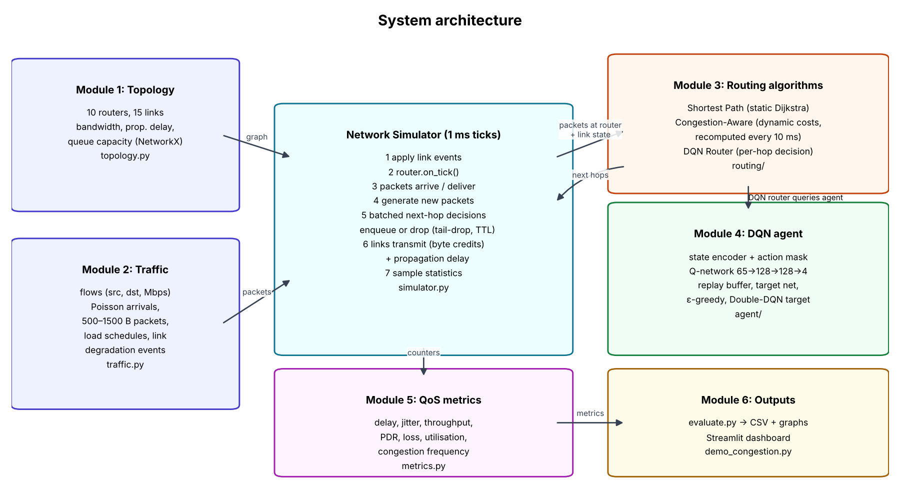

### 3.1 Topology (Module 1)

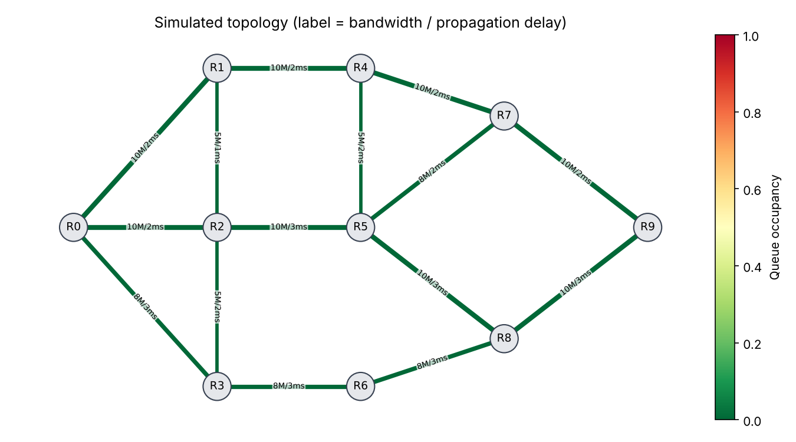

10 routers and 15 full-duplex links built with NetworkX. Links have 5, 8 or 10 Mbps bandwidth and
1–3 ms propagation delay; each direction has its own 30-packet FIFO queue. The graph was designed
so that busy source/destination pairs have 3–4 alternative paths and the minimum-delay paths
overlap on the R0–R1–R4–R7–R9 core.

### 3.2 Traffic and simulation (Module 2)

* **Time:** discrete ticks of 1 ms.
* **Traffic:** each flow (src, dst, rate) generates packets as a Poisson process; packet sizes are
  uniform 500–1500 bytes. The evaluation "hotspot" matrix has 7 flows (R0→R9 6 Mbps, R1→R7 3,
  R0→R7 3, R3→R9 3, R2→R8 2, R9→R0 4, R6→R4 2 Mbps at load 1.0 ≈ 23 Mbps total).
* **Links:** byte-credit scheduler — a busy link earns its bandwidth in bytes every ms and sends
  whole packets while credit ≥ packet size; the packet arrives after the propagation delay.
* **Loss:** tail-drop when the queue is full; TTL = 12 hops.
* **Dynamics:** load schedules (piecewise-constant) and link-degradation events (bandwidth ×
  factor for a time window).
* **Run:** traffic for `duration` ms, then a 300 ms drain with no new packets.

### 3.3 Routing baselines (Module 3)

* **Shortest Path:** Dijkstra with cost = propagation delay; next-hop tables computed once.
* **Congestion-Aware heuristic:** every 10 ms, cost(u→v) = prop + queue_bytes/bandwidth +
  1000 B/bandwidth (+20 if the queue is ≥ 90 % full); Dijkstra recomputes all next-hop tables.

### 3.4 DQN agent (Module 4)

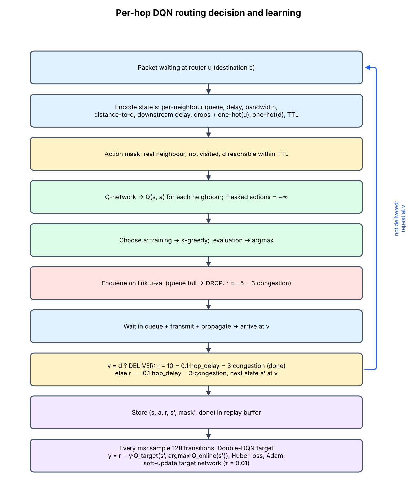

**Decision:** at each router, for each packet, choose a neighbour. All routers share one network.

**State (65 values).** Per neighbour slot (4 × 11): slot exists, queue occupancy, queue delay
(/30 ms), propagation delay (/5), bandwidth (/10 Mbps), hops neighbour→destination (/6),
propagation delay neighbour→destination (/15), downstream queue delay (best queue delay out of the
neighbour towards the destination, /30), neighbour-is-destination, recent drops (EMA), recent
utilisation (EMA); plus one-hot current router (10), one-hot destination (10) and remaining TTL
fraction (1).

**Action mask.** Allowed: existing neighbours, not previously visited by this packet, from which
the destination is reachable within the remaining TTL. Fallback: allow revisits at a dead end.

**Reward per hop.**
`r = 10·delivered − 0.1·hop_delay_ms − 5·dropped − 3·congestion_penalty`,
congestion_penalty = clip((occupancy − 0.7)/0.3, 0, 1) of the chosen queue. Summing over a path
yields 10 − 0.1 × end-to-end delay minus penalties.

**Network and learning.** MLP 65 → 128 → 128 → 4 (ReLU); Huber loss; Adam (lr 5·10⁻⁴); gradient
norm clipped at 10; replay buffer 100,000; batch 128; one gradient step per simulated ms after
2,000 transitions; Double-DQN target with a soft-updated target network (τ = 0.01); γ = 0.98;
ε-greedy decaying linearly from 1.0 to 0.05 over 60 % of training. The network is implemented in
NumPy with explicit back-propagation (verified by a finite-difference gradient test); an
equivalent PyTorch backend is provided.

**Training.** 300 episodes; each is a new random scenario: the hotspot matrix or a random matrix
(4–8 flows, 1–5 Mbps), load 0.3–2.0, a load step with probability 0.3, a link degradation (20–60 %
bandwidth) with probability 0.5; 1,000 ms traffic + 150 ms drain. Every 10 episodes the greedy
policy is scored on validation scenarios (moderate, heavy, dynamic; two validation seeds) with
score = 10 × PDR − 0.1 × average delay; the best model is saved.

### 3.5 QoS metrics (Module 5)

Only packets generated during the traffic window are counted; each ends delivered, dropped or in
flight. Average/95th-percentile delay over delivered packets; jitter = per-flow mean absolute
difference of consecutive delivered-packet delays, averaged over flows; throughput = delivered
bytes × 8 / duration; PDR = delivered / generated; loss = drops / generated; utilisation per
directed link = bytes sent / bytes sendable; congestion frequency = fraction of (link, ms) samples
with queue ≥ 80 %.

### 3.6 Dashboard (Module 6)

Streamlit app with: scenario controls (source/destination, traffic intensity, background traffic,
link-degradation injection, seed, algorithms); QoS table; topology coloured by queue occupancy at a
chosen time with the paths taken by the tracked flow before/during/after the event; time series of
delay, demo-flow delay, drops and queue backlog; offline result figures and a live load sweep; DQN
training curves and model metadata.

## 4. Implementation

Python 3, NumPy, NetworkX, Matplotlib, pandas, Streamlit (PyTorch optional). Code is organised as a
package (`qosroute/`) with separate modules for topology, traffic, simulator, metrics, routing,
agent, experiments, demo and plotting; scripts for training, evaluation, the terminal demo and
diagrams; and unit tests for conservation of packets, delay bounds, queue limits, static routing,
gradient correctness, replay buffer, action masking, loop freedom, a dashboard smoke test, and
NumPy/PyTorch equivalence.

## 5. Experimental methodology

* **Seeds:** training (stream seeded 0), validation (500001–500002), test (900000–900004). All
  algorithms see identical packet arrivals for a given seed.
* **Experiments:** (1) load sweep 0.25–2.0, hotspot matrix, 5 seeds × 2,000 ms; (2) named
  scenarios light (0.4), moderate (0.9), heavy (1.6) and dynamic (load 0.4 → 1.0 → 1.6 → 0.8 at
  quarters of the run, link R4–R7 at 30 % bandwidth during the middle third), 5 seeds;
  (3) generalisation: 10 random traffic matrices not used in training at loads 0.8 and 1.4;
  (4) sensitivity: heuristic recomputing every 50 ms and 100 ms instead of 10 ms.
* **Reporting:** mean ± standard deviation across seeds (or across matrices for experiment 3).

## 6. Results

All numbers: mean ± standard deviation over 5 test seeds (2,000 ms of traffic each); full tables in
`results/RESULTS.md`, raw runs in `results/eval_runs.csv`.

### 6.1 Training

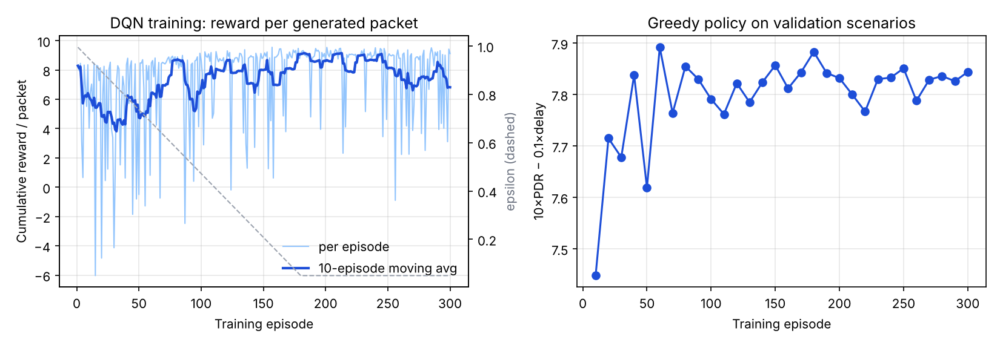

The 10-episode moving average of reward per generated packet dips to ≈ 4–6 while exploration is
high (ε > 0.6, mostly random routes) and then stays around 7–9; its large episode-to-episode
variation comes mainly from the random load of each training episode (overloaded episodes have
drops and long delays whatever the policy). The greedy validation score rose from 7.45 (episode 10)
to 7.89 (episode 60) and then stayed between 7.76 and 7.89 for the remaining 240 episodes. The saved
model is the episode-60 checkpoint; given the small validation set (6 runs), differences after
episode 60 are within noise. For reference, on the same validation scenarios shortest path scored
2.86 and the heuristic 7.35. Training took 19 minutes on 2 CPU cores (NumPy backend).

### 6.2 Load sweep

| | | |
|---|---|---|
| 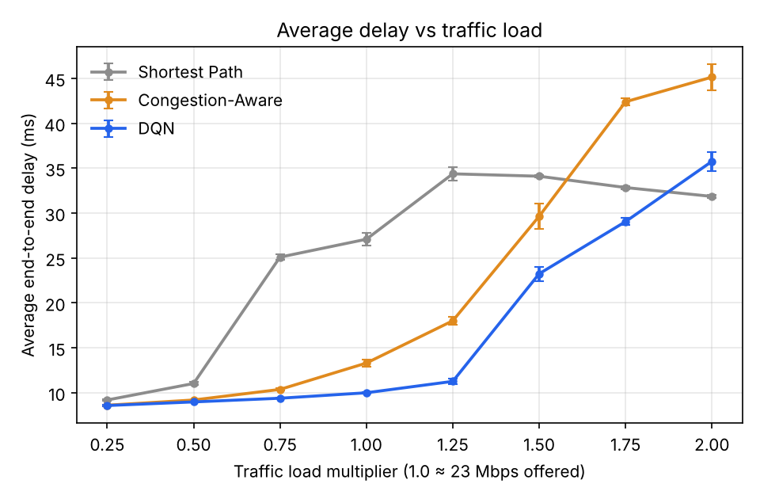 | 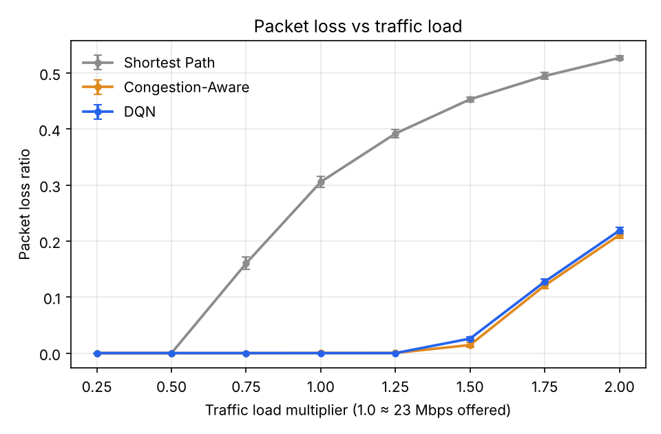 | 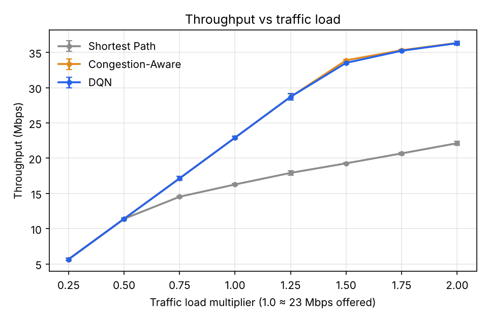 |
| 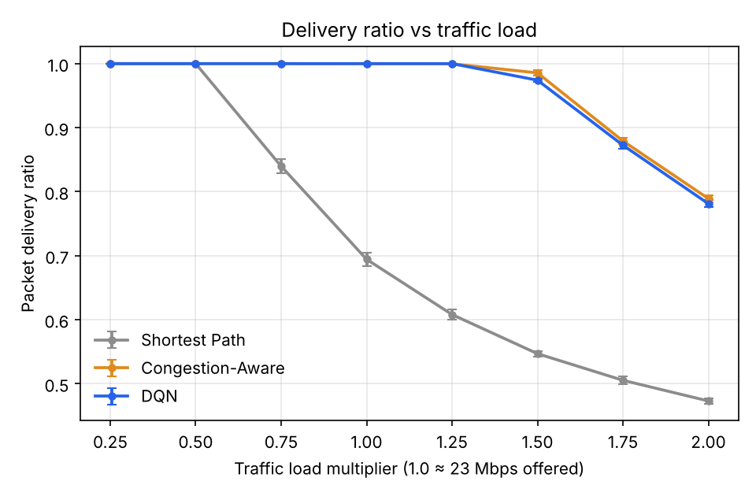 | 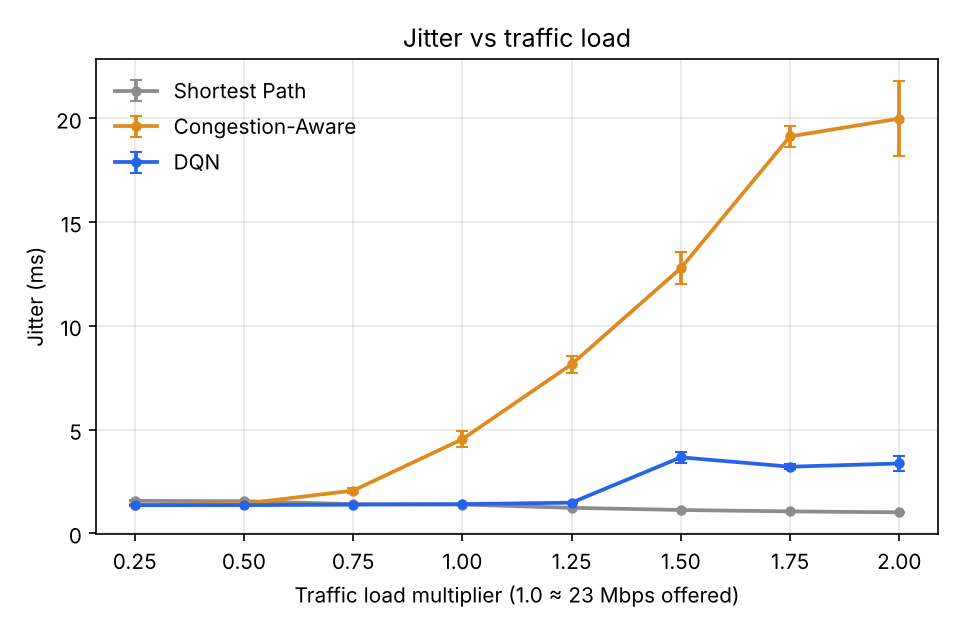 | 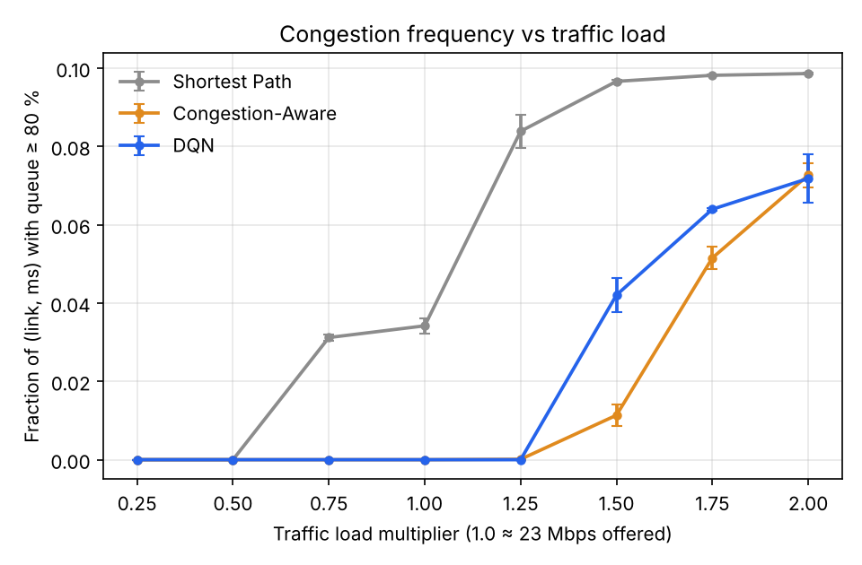 |

Selected values (hotspot matrix):

| Load | Metric | Shortest Path | Congestion-Aware | DQN |
|---|---|---|---|---|
| 0.5 | delay (ms) | 11.0 ± 0.2 | 9.2 ± 0.0 | **9.0 ± 0.0** |
| 0.75 | PDR | 0.840 ± 0.011 | **1.000** | **1.000** |
| 0.75 | delay (ms) | 25.1 ± 0.3 | 10.4 ± 0.1 | **9.4 ± 0.0** |
| 1.0 | PDR | 0.694 ± 0.010 | **1.000** | **1.000** |
| 1.0 | delay (ms) | 27.1 ± 0.7 | 13.3 ± 0.4 | **10.0 ± 0.1** |
| 1.0 | jitter (ms) | 1.38 ± 0.02 | 4.54 ± 0.40 | 1.40 ± 0.03 |
| 1.25 | delay (ms) | 34.4 ± 0.8 | 18.0 ± 0.5 | **11.3 ± 0.3** |
| 1.5 | PDR | 0.547 ± 0.004 | **0.986 ± 0.004** | 0.974 ± 0.003 |
| 1.5 | delay (ms) | 34.1 ± 0.1 | 29.6 ± 1.4 | **23.2 ± 0.8** |
| 2.0 | PDR | 0.473 ± 0.004 | **0.789 ± 0.006** | 0.781 ± 0.005 |
| 2.0 | throughput (Mbps) | 22.1 ± 0.3 | 36.4 ± 0.3 | 36.3 ± 0.3 |

Observations:

* **Light load (≤ 0.5):** no congestion; all methods deliver everything. Adaptive methods are
  ~1–2 ms faster because they also use parallel paths.
* **Shortest path collapses from load 0.75:** its fixed paths overlap on R1→R4 and on the feeder links
  R3→R2→R1, which run at 98–100 % utilisation at load 1.0, so loss climbs to 16 % at 0.75 and 53 % at 2.0 while throughput
  flattens at ~16–22 Mbps. Its *delay* stops rising and even falls at high load — not because it
  performs well, but because delay is measured only over delivered packets and it drops more and
  more of them.
* **Up to capacity (0.75–1.25)** the DQN and the heuristic both deliver 100 %, and the DQN has
  consistently lower delay (by 1–7 ms) and 1.5–5.5× lower jitter. The heuristic recomputes all
  routes every 10 ms and moves whole destinations between paths at once, which causes route
  flapping (visible as jitter up to 20 ms); the DQN decides per packet with current queue values,
  spreading load more smoothly.
* **Overload (≥ 1.5)**: total offered traffic (≥ 34 Mbps) exceeds what the network can carry
  to these destinations, so both adaptive methods lose packets. The heuristic delivers 0.6–1.2
  percentage points more (at load 1.5 the gap exceeds the seed-to-seed spread; at 1.75–2.0 it is
  about the size of it), while the DQN keeps 21–32 % lower delay and 3.5–6× lower jitter. The DQN also runs
  queues fuller more often (congestion frequency 0.042 vs 0.011 at load 1.5): it tolerates queues
  on short paths that the heuristic's ≥ 90 % penalty avoids.

### 6.3 Named and dynamic scenarios

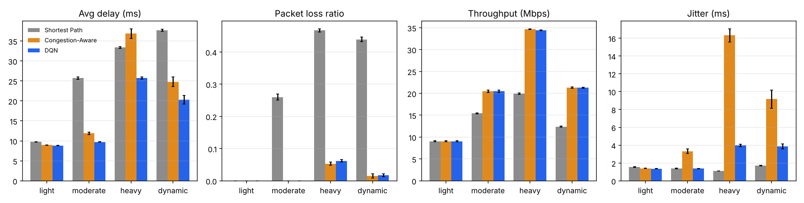

| Scenario | Metric | Shortest Path | Congestion-Aware | DQN |
|---|---|---|---|---|
| light (0.4) | delay / PDR | 9.8 / 1.000 | 8.9 / 1.000 | **8.8 / 1.000** |
| moderate (0.9) | delay / PDR | 25.7 / 0.740 | 11.9 / 1.000 | **9.7 / 1.000** |
| heavy (1.6) | delay / PDR | 33.4 / 0.533 | 36.9 / **0.947** | **25.7** / 0.938 |
| dynamic | delay / PDR | 37.7 / 0.561 | 24.8 / **0.985** | **20.3** / 0.982 |
| dynamic | jitter (ms) | 1.71 | 9.17 | 3.87 |

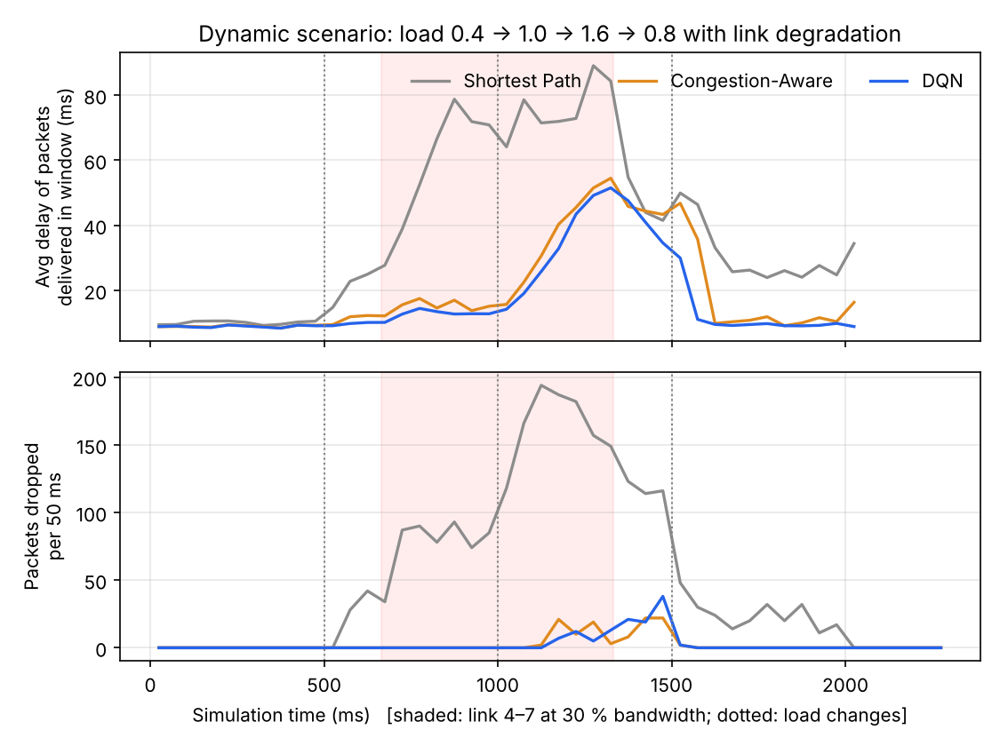

In the dynamic scenario, shortest path keeps sending traffic over the degraded R4–R7 link and
drops up to ~190 packets per 50 ms. Both adaptive methods route around it; their delays rise only
when the load step to 1.6 coincides with the degradation (≈ 1000–1500 ms), and both drop a few
packets then. PDR difference between them (0.985 vs 0.982) is within one standard deviation.

### 6.4 Generalisation to unseen traffic matrices

On 10 random traffic matrices never used in training (4–8 flows, 1–5 Mbps each), both adaptive
methods delivered 100 % of packets at loads 0.8 and 1.4, whereas shortest path delivered 96.5 % and
86.5 % on average. Comparing the same matrix and seed, the DQN had lower average delay than the
heuristic in 8/10 matrices at load 0.8 and 7/10 at load 1.4 (means 7.1 vs 7.3 ms and 9.5 vs
10.0 ms) — a small advantage. The policy is therefore not tied to the hotspot matrix, although it
is tied to this topology.

### 6.5 Sensitivity to the heuristic's update interval

With link-state updates every 50 ms or 100 ms instead of 10 ms, the heuristic's delivery ratio in
the heavy scenario falls from 0.947 to 0.706 and 0.639, and in the dynamic scenario from 0.985 to
0.854 and 0.783: stale information makes it oscillate onto paths that have already filled. The
DQN uses current local state at every hop, so this comparison mostly shows how much the heuristic
depends on frequent, free and instantaneous global updates — an assumption that is optimistic in
real networks, where collecting state costs bandwidth and time.

### 6.6 Congestion-injection demo

`results/demo_output.txt` (demo flow R0→R9, 4 Mbps; background load 0.6; R4–R7 at 20 % bandwidth
from 700 to 1400 ms, seed 7):

| | Shortest Path | Congestion-Aware | DQN |
|---|---|---|---|
| Demo-flow delay during event | 155.1 ms (68 of ~350 packets delivered) | 22.8 ms | 16.7 ms |
| Demo-flow paths during event | 100 % via R4–R7 | R4–R7 not among its top 3 paths | R4–R7 not among its top 3 paths (uses R4–R5–R7, R2–R5–R7, R5–R8) |
| Network-wide PDR / delay | 0.602 / 44.7 ms | 1.000 / 14.8 ms | 1.000 / 11.6 ms |

After the event the adaptive methods move traffic back to R4–R7.

## 7. Discussion

**Is the DQN better?** In this simulator, clearly better than static shortest path, and
comparable to a strong congestion-aware heuristic: equal delivery up to capacity with lower delay
and jitter; slightly lower delivery (0.6–1.2 percentage points) but lower delay and jitter under
overload. It is not uniformly superior, and we do not claim it is.

**Why lower delay and jitter?** Three design choices explain most of it: (1) per-hop decisions
with the queue state of the current millisecond instead of a table refreshed every 10 ms;
(2) per-packet spreading across several paths instead of moving all traffic of a destination at
once; (3) the downstream-delay feature, which lets the agent see congestion one hop ahead.

**Why slightly more loss under overload?** The reward weights trade loss against delay. The agent
accepts fuller queues on short paths (higher congestion frequency) because, summed over a path, a
long detour costs delay on every packet while drops are rarer. A larger drop penalty or a
congestion penalty starting below 70 % occupancy would likely shift this trade-off; we did not
tune it.

**Fairness caveats.** The DQN reads exact current queue state locally and one hop ahead every
millisecond; the heuristic reads exact global state every 10 ms. Neither pays for collecting it.
The heuristic's sensitivity to its update interval (§6.5) shows that information freshness is a
large part of the story. Per-packet routing would also reorder TCP packets; this is not
penalised here.

**What the agent learned.** At light load it mostly follows the minimum-delay path; as queues on
that path fill it shifts a growing share of packets to alternatives, and it reacts within
milliseconds to a degraded link (bandwidth feature drops, queue grows) without having seen that
specific event in training.

## 8. Limitations

* **Simulation, not measurement.** Numbers are outputs of a simplified model with 1 ms
  resolution; they indicate relative behaviour of the algorithms in this model only.
* **No transport-layer feedback.** Senders never slow down after loss (no TCP), so overload persists.
* **Idealised information.** The DQN reads exact local queue state every ms plus one-hop
  downstream state; the heuristic gets exact global state every 10 ms. Neither pays signalling
  overhead or delay for collecting it.
* **Per-packet routing** can reorder packets of a flow, which would hurt TCP in practice.
* **One topology.** One-hot router IDs tie the model to this 10-router graph; a new topology needs
  retraining.
* **Limited tuning.** Reward weights are the brief's illustrative values; hyper-parameters were
  chosen once, not searched; 300 training episodes; one training seed.
* **Statistical scope.** 5 test seeds per point; standard deviations are reported but no formal
  significance tests.

## 9. Future work

Run the trained policy in an SDN controller (Ryu/ONOS) on Mininet with real traffic generators;
flow- or flowlet-level decisions to avoid reordering; graph neural network state encoders for
topology independence; reward-weight and hyper-parameter sweeps; multiple training seeds;
prioritized replay; link failures with detection delay; comparison with ECMP and Q-routing.

## 10. Conclusion

We built a complete, tested packet-level simulation framework, two conventional baselines and a
DQN-based adaptive router with action masking, trained on randomised scenarios and evaluated on
held-out seeds and unseen traffic matrices. Adaptive routing removes the large losses of static
shortest-path routing under hotspot traffic. The DQN matched a 10 ms-refresh congestion-aware
heuristic on delivery up to capacity, with lower delay and markedly lower jitter, and traded about
one percentage point of delivery for lower delay under overload. The main open questions are
whether these gains survive realistic state-collection delays, flow-level forwarding and real
traffic, which the Mininet/SDN extension would answer.

## References

1. Y. Song, M. Ni, J. Liu, "Deep reinforcement learning for network routing optimization: A
   systematic survey," *Neurocomputing*, vol. 666, art. 132263, 2026.
   doi:10.1016/j.neucom.2025.132263
2. L. P. Aguirre Sanchez, Y. Shen, M. Guo, "MDQ: A QoS-Congestion Aware Deep Reinforcement
   Learning Approach for Multi-Path Routing in SDN," *Journal of Network and Computer
   Applications*, vol. 235, art. 104082, 2025. doi:10.1016/j.jnca.2024.104082
3. J. A. Boyan, M. L. Littman, "Packet Routing in Dynamically Changing Networks: A Reinforcement
   Learning Approach," *Advances in Neural Information Processing Systems 6*, 1994.
4. V. Mnih et al., "Human-level control through deep reinforcement learning," *Nature*, vol. 518,
   pp. 529–533, 2015.
5. H. van Hasselt, A. Guez, D. Silver, "Deep Reinforcement Learning with Double Q-learning,"
   *Proc. AAAI*, 2016.
6. G. Stampa, M. Arias, D. Sánchez-Charles, V. Muntés-Mulero, A. Cabellos, "A Deep-Reinforcement
   Learning Approach for Software-Defined Networking Routing Optimization," arXiv:1709.07080, 2017.
7. P. Almasan et al., "Deep Reinforcement Learning meets Graph Neural Networks: exploring a routing
   optimization use case," arXiv:1910.07421, 2019.
8. R. S. Sutton, A. G. Barto, *Reinforcement Learning: An Introduction*, 2nd ed., MIT Press, 2018.
9. J. F. Kurose, K. W. Ross, *Computer Networking: A Top-Down Approach*, 8th ed., Pearson, 2021.
10. H. Schulzrinne et al., "RTP: A Transport Protocol for Real-Time Applications," RFC 3550, 2003.

*References 1–2 were checked against the publisher/ACM records; please confirm 3–10 in your
library's database before submission, and format them in the style your department requires.*

## Appendix A — How to reproduce

```bash
pip install -r requirements.txt
python scripts/train.py          # ~15–20 min, writes models/ and results/training_log.csv
python scripts/evaluate.py       # writes results/*.csv, RESULTS.md, figures/
python -m pytest -q
streamlit run dashboard/app.py
```
